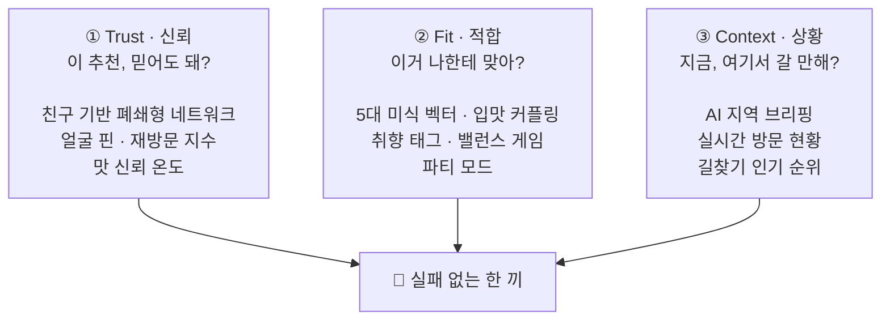
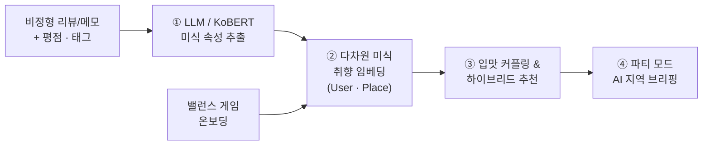
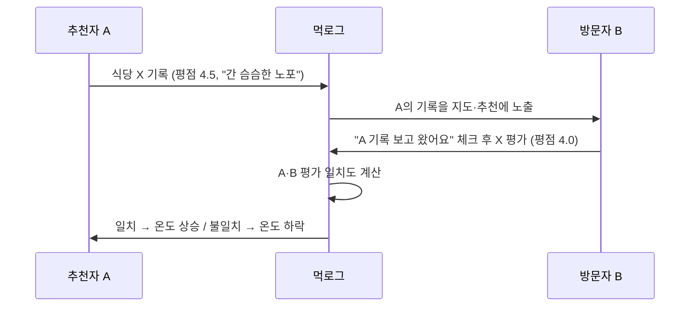
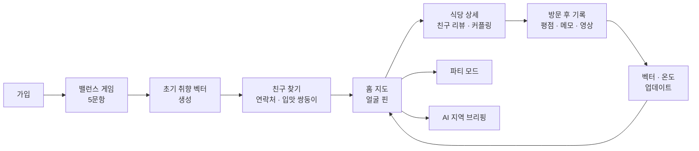
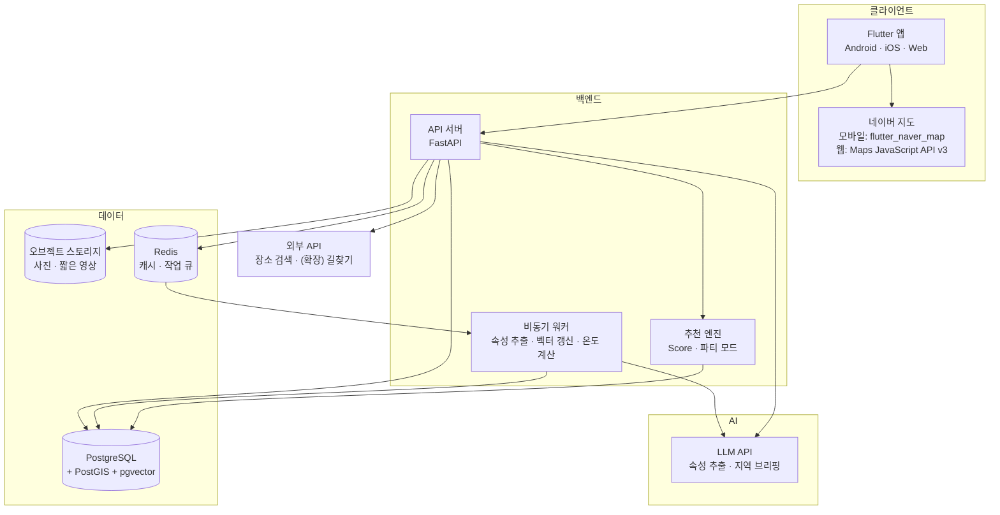
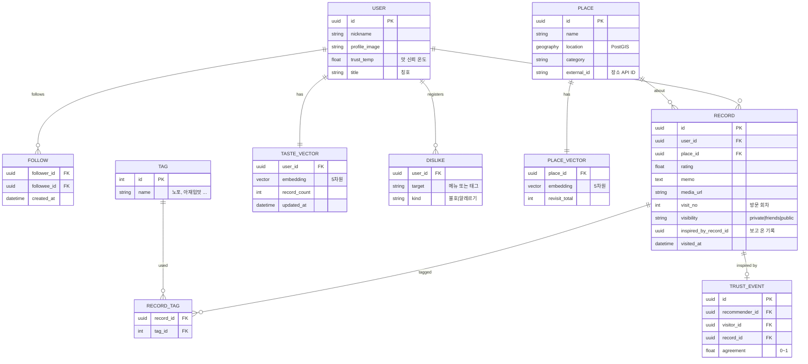
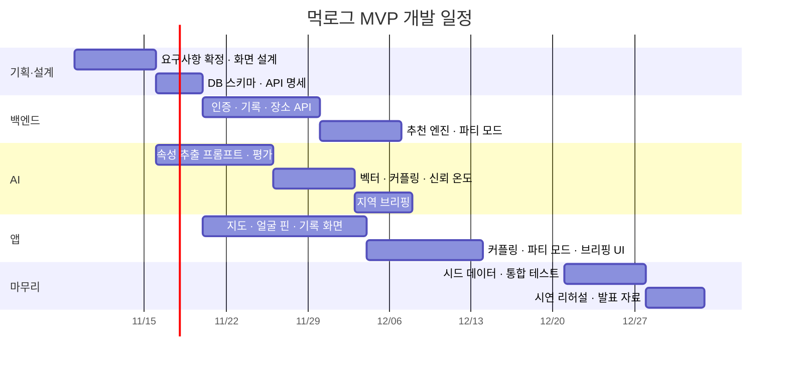
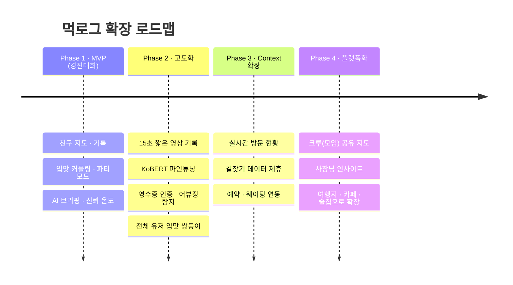

# 먹로그 (MUKlog)

> **광고 없는 신뢰 네트워크 기반 개인화 미식 아카이빙 플랫폼**
>
> 불특정 다수의 별점 대신, 믿을 수 있는 사람의 입맛으로 맛집을 고르는 소셜 지도

---

## 목차

1. [개요](#1-개요)
2. [문제 정의](#2-문제-정의)
3. [대상 사용자](#3-대상-사용자)
4. [핵심 컨셉: Trust · Fit · Context](#4-핵심-컨셉-trust--fit--context)
5. [주요 기능 명세](#5-주요-기능-명세)
6. [AI 기술 설계](#6-ai-기술-설계)
7. [맛 신뢰 온도 & 레벨·칭호 시스템](#7-맛-신뢰-온도--레벨칭호-시스템)
8. [사용자 흐름 & 화면 구성](#8-사용자-흐름--화면-구성)
9. [시스템 아키텍처 & 기술 스택](#9-시스템-아키텍처--기술-스택)
10. [데이터 모델](#10-데이터-모델)
11. [차별성 & 경쟁 서비스 비교](#11-차별성--경쟁-서비스-비교)
12. [MVP 범위 & 개발 일정](#12-mvp-범위--개발-일정)
13. [심사 시연 시나리오](#13-심사-시연-시나리오)
14. [기대 효과 & 비즈니스 모델](#14-기대-효과--비즈니스-모델)
15. [리스크 & 대응 방안](#15-리스크--대응-방안)
16. [향후 확장 로드맵](#16-향후-확장-로드맵)

---

## 1. 개요

먹로그는 광고 대신 친구의 실제 방문 기록과 AI 입맛 분석으로 "실패 없는 한 끼"를 찾아 주는 친구 기반 소셜 미식 지도입니다.

| 항목 | 내용 |
| --- | --- |
| 서비스명 | 먹로그 (MUKlog) |
| 슬로건 | 광고 없는 신뢰 네트워크 기반 개인화 미식 아카이빙 플랫폼 |
| 형태 | Android · iOS · 웹 크로스플랫폼 앱 (지도 + 소셜 피드 + AI 추천) |
| 핵심 기술 | 리뷰 NLP 속성 추출, 미식 취향 벡터, 유사도 기반 하이브리드 추천, LLM 요약 |
| 출전 목표 | 동작하는 MVP와 "입맛 커플링 → 파티 모드 → AI 브리핑" 3단 라이브 시연 |

"오늘 뭐 먹지?"라는 질문 뒤에는 광고와 조작된 리뷰 속에서 반복되는 실패의 피로가 있습니다. 정보는 늘었지만 믿을 수 있는 정보를 찾는 비용은 오히려 커졌습니다. 먹로그는 가장 원초적인 검증 수단인 **친구의 추천**에 NLP와 벡터 임베딩을 더해, 친목을 넘어 개인의 미세한 미각 성향까지 계산합니다.

## 2. 문제 정의

기존 맛집 플랫폼은 "누구의 말을 믿을지"와 "나에게 맞는지"에 모두 답하지 못합니다.

| 문제 | 현상 | 결과 |
| --- | --- | --- |
| 정보 신뢰도 붕괴 | 블로그 체험단, 영수증 리뷰 대행, 별점 이벤트 | 실제 품질과 진정성을 판별하기 어려움 |
| 획일화된 평점 | "별점 4.5" 하나로 줄 세우기 | 간의 세기·분위기·가성비 등 개인차 무시 |
| 지인 추천의 휘발성 | 단톡방에서 "이 근처 맛집 알아?" | 정보가 흘러가 버리고 지도에서 다시 찾기 어려움 |
| 웨이팅 피로 | SNS 유명 식당의 2~3시간 대기 | 유명세와 실제 만족도의 괴리 |

사용자가 원하는 것은 불특정 다수의 바이럴이 아니라 **나와 입맛이 비슷한 사람의 검증된 추천**입니다.

## 3. 대상 사용자

광고성 정보에 지친 2030 세대가 핵심 타깃이며, 기록하는 사람(공급자)과 찾는 사람(수요자)을 모두 포함합니다.

| 페르소나 | 상황 | 필요 | 먹로그의 답 |
| --- | --- | --- | --- |
| 기록러 (25세, 직장인) | 가본 곳이 메모장·사진첩에 흩어져 있음 | 나만의 솔직한 맛집 리스트 | 개인 아카이빙 + 짧은 영상 기록 |
| 탐색러 (23세, 대학생) | 약속 장소를 정할 때마다 블로그 광고에 실패 | 믿을 만한 근처 맛집 | 친구 레이어 + AI 지역 브리핑 |
| 모임 주선자 (29세) | 친구들 취향이 달라 장소 정하기가 어려움 | 모두 만족할 교집합 장소 | 파티 모드 |
| 미식가 (31세) | 추천을 잘해도 인정받을 방법이 없음 | 영향력과 인정 | 맛 신뢰 온도 + 칭호 |

## 4. 핵심 컨셉: Trust · Fit · Context

모든 기능은 사용자가 식당을 고를 때 던지는 세 가지 질문에 답하도록 설계됩니다.



세 축은 하나의 추천 점수로 합쳐집니다.

```
최종 추천 점수 = Fit(나와 맞는가) × Trust(누가 보증하는가) × Context(지금 갈 만한가)
```

기존 플랫폼은 단일 평점으로 Trust만 흉내 내고 Fit은 다루지 않습니다. 먹로그는 세 축을 모두 계산합니다.

## 5. 주요 기능 명세

기능은 데이터를 쌓는 **Core**, 차별점인 **AI**, 시연용 **Killer**, 참여를 이끄는 **Growth**, 외부 데이터가 필요한 **확장**으로 나뉩니다.

| 기능 | 계층 | 축 | 설명 |
| --- | --- | --- | --- |
| 얼굴 핀(Face-Pin) 지도 | Core | Trust | 후기 등록 시 작성자 프로필 얼굴이 지도 핀으로 표시. 같은 식당에 여러 친구가 있으면 얼굴이 겹쳐 표시됨 |
| 친구 레이어 | Core | Trust | 팔로우한 친구의 '가본 곳'과 '가고 싶은 곳'을 레이어로 켜고 끔 |
| 개인 아카이빙 | Core | — | 공개 범위(나만/친구/전체)를 고르는 솔직한 맛집 기록장. 평점, 메모, 15초 이내 짧은 영상 |
| 재방문 기록 | Core | Trust | 같은 식당 재방문 시 회차 누적. "친구 3명이 총 11번 간 곳" 형태로 노출 |
| 취향 태그 | Core | Fit | 노포, 아재입맛, 혼밥, 안주맛집, 데이트, 가성비 등. 태그로 지도 필터링 |
| 밸런스 게임 온보딩 | AI | Fit | 가입 시 5문항(예: 평양냉면 vs 함흥냉면, 노포 vs 인스타 감성)으로 초기 취향 벡터 생성 |
| 입맛 커플링 지수 | AI | Fit | 친구·유저와 나의 입맛 일치도를 0~100%로 표시하고 차원별 차이를 레이더 차트로 비교 |
| 입맛 쌍둥이 추천 | AI | Fit | 친구가 아닌 전체 유저 중 커플링 지수가 높은 사람을 추천해 팔로우 유도 |
| 개인화 추천 리스트 | AI | 전체 | Fit × Trust × Context 점수 순으로 근처 식당 정렬 |
| 파티 모드 | Killer | Fit | 2인 이상 선택 시 취향 벡터를 결합하고 불호·알레르기를 배제해 교집합 장소 추천 |
| AI 지역 브리핑 | Killer | Context | 지역(홍대, 강남 등)을 켜면 "친구 3명이 공통으로 추천한 분위기 좋은 안주 맛집"처럼 자연어로 요약 |
| 맛 신뢰 온도·칭호 | Growth | Trust | 내 추천을 보고 간 사람들의 만족도로 온도 산출, 레벨·칭호를 지도 핀에 표시 ([7장](#7-맛-신뢰-온도--레벨칭호-시스템)) |
| 미식가 랭킹 | Growth | Trust | 지역·카테고리별 신뢰 온도 순위 (친구 랭킹 / 전체 랭킹) |
| 현재 방문 현황 | 확장 | Context | 최근 1시간 체크인 수로 "지금 n명이 가는 중" 표시, 웨이팅 회피 |
| 길찾기 인기 순위 | 확장 | Context | 내비게이션 목적지 데이터 제휴 시 실제 이동 기반 인기 지표 반영 |

## 6. AI 기술 설계

AI는 비정형 리뷰를 5차원 미식 벡터로 바꾸고, 그 벡터로 유사도·추천·요약을 계산하는 4단계 파이프라인입니다.



### 6.1 미식 속성 추출 (NLP)

리뷰·메모 텍스트에서 5대 미식 차원을 각각 -1~+1 점수로 추출합니다.

| 차원 | -1 쪽 | +1 쪽 | 리뷰 예시 → 추출값 |
| --- | --- | --- | --- |
| 간의 세기 | 슴슴함 | 자극적 | "간이 심심해서 좋았음" → -0.7 |
| 매운맛 선호 | 안 매운 맛 | 아주 매운 맛 | "맵부심 자극하는 맛" → +0.8 |
| 분위기 | 노포·서민 | 모던·감성 | "오래된 노포 느낌" → -0.9 |
| 가성비 민감도 | 가격 무관 | 가성비 중시 | "이 가격에 이 양이면" → +0.6 |
| 메뉴 지향성 | 한식·토속 | 양식·이국 | "엄마 집밥 같은 한식" → -0.8 |

- **MVP:** 경량 LLM API에 구조화 출력(JSON) 프롬프트를 사용해 바로 추출합니다. 학습 데이터 없이 시작할 수 있습니다.
- **고도화:** LLM 추출 결과를 약한 정답(pseudo-label)으로 삼아 KoBERT 계열 모델을 파인튜닝하면 비용과 지연을 줄일 수 있습니다.
- 추출이 어려운 리뷰는 해당 차원을 비워 두고(null), 태그와 평점으로 보완합니다.

추출 프롬프트 출력 예시:

```json
{
  "saltiness": -0.7,
  "spiciness": 0.0,
  "ambience": -0.9,
  "value": 0.6,
  "cuisine": -0.8,
  "tags": ["노포", "아재입맛"],
  "evidence": ["간이 심심해서 좋았음", "오래된 노포 느낌"]
}
```

### 6.2 취향 벡터 구축

- **식당 벡터 `V_i`:** 해당 식당 리뷰들의 추출값 평균입니다.
- **사용자 벡터 `V_u`:** 내가 높게 평가한 식당 벡터의 평점 가중 평균입니다. 재방문한 식당은 가중치를 더 줍니다.
- **Cold Start:** 온보딩 밸런스 게임 5문항이 각 차원의 초깃값을 정합니다. 기록이 쌓일수록 게임 결과의 비중을 줄입니다.

```
V_u = α · V_onboarding + (1 − α) · Σ_i w_i · V_i / Σ_i w_i
w_i = (평점_i − 3) × (1 + log(1 + 재방문수_i))
α   = 1 / (1 + 기록수 / 5)     # 기록 5개면 온보딩 비중 50%
```

### 6.3 입맛 커플링 지수

두 사용자 벡터의 코사인 유사도를 0~100%로 변환합니다. 값을 -1~+1로 두어 중심이 0이므로, 아무나 비교해도 90%가 나오는 문제를 피합니다.

```
Couple(A, B) = 50 × (1 + cos(V_A, V_B))   [%]
```

같은 식당에 남긴 평점이 3개 이상이면 평점 상관관계(피어슨)도 함께 반영합니다.

### 6.4 하이브리드 추천 점수

내 취향과 식당의 적합도에, 나와 입맛이 비슷하고 신뢰 온도가 높은 친구의 재방문을 곱합니다.

```
Score(u, i) = Sim(V_u, V_i)
            × (1 + log(1 + Σ_{f∈F_u} Sim(V_u, V_f) · T_f · R_f(i)))
            × C(i)
```

| 기호 | 의미 |
| --- | --- |
| `F_u` | u의 친구(및 입맛 쌍둥이) 집합 |
| `T_f` | 친구 f의 맛 신뢰 온도를 0~1로 정규화한 값 |
| `R_f(i)` | f의 식당 i 방문 횟수 (재방문 포함) |
| `C(i)` | Context 보정 (거리, 영업 여부, 혼잡도). MVP에서는 거리 감쇠만 적용 |

### 6.5 파티 모드 (그룹 최적화)

1. **제약 필터:** 구성원 중 한 명이라도 불호·알레르기로 등록한 메뉴·태그의 식당을 제외합니다.
2. **그룹 벡터:** 구성원 벡터의 가중 평균(기본 동일 가중치)으로 추천 후보를 뽑습니다.
3. **최소 만족 보장:** 평균이 높아도 한 명의 예상 만족도가 낮으면 탈락시킵니다.
   `최종 점수 = 0.7 × 평균 만족 + 0.3 × 최소 만족`
4. **설명:** "A님의 노포 취향과 B님의 가성비 취향을 모두 만족" 같은 추천 이유를 함께 보여 줍니다.

### 6.6 AI 지역 브리핑 (LLM 요약)

1. 지역 범위 안의 친구 기록을 모으고, 점수 상위 식당을 고릅니다.
2. 식당별로 추천한 친구 수, 공통 태그, 리뷰 발췌를 구조화해 LLM에 전달합니다.
3. LLM은 주어진 데이터만으로 3~5문장 브리핑을 작성합니다.
   > "홍대에서는 친구 3명이 공통으로 'OO포차'를 분위기 좋은 안주 맛집으로 꼽았고, 민수님은 4번이나 재방문했어요."
4. 문장마다 근거가 된 리뷰를 연결해 환각(없는 내용 생성)을 막습니다.

## 7. 맛 신뢰 온도 & 레벨·칭호 시스템

입맛 커플링이 "나와 비슷한 사람"을 찾아 준다면, 맛 신뢰 온도는 "누구에게나 믿을 만한 사람"을 찾아 줍니다. 당근의 매너온도처럼 직관적인 숫자로 표현합니다.

### 7.1 정의

> **맛 신뢰 온도** = 이 사람의 추천을 믿고 간 사람들이 실제로 얼마나 만족했는가

### 7.2 산출 흐름



- **일치도:** `1 − |평점_A − 평점_B| / 4` (0~1). 0.75 이상이면 긍정, 0.5 미만이면 부정으로 봅니다.
- **입맛 차이 보정:** B와 A의 커플링 지수가 낮은데도 만족했다면 가산점을 더 줍니다. 입맛이 다른 사람도 만족시켰다는 뜻이기 때문입니다.
- **베이지안 보정:** 평가 표본이 적을 때는 기본값 36.5℃ 쪽으로 당겨서, 초기 몇 건으로 온도가 급변하지 않게 합니다.

```
온도 = 36.5 + k × (Σ 가중 일치 점수 − 기대값) / (n + m)
       # m = 사전 표본 수(예: 10), 표본이 적을수록 36.5℃에 가까움
```

### 7.3 레벨·칭호

| 온도 구간 | 레벨 | 지도 표시 |
| --- | --- | --- |
| 36.5℃ 미만 | 새내기 먹로거 | 기본 핀 |
| 36.5~40℃ | 동네 맛잘알 | 핀 테두리 색 |
| 40~45℃ | 지역 감별사 | 칭호 배지 (예: "홍대 국밥 감별사") |
| 45℃ 이상 | 먹로그 마스터 | 특수 핀 + 랭킹 상단 고정 |

- 칭호는 **지역 + 카테고리**로 자동 생성됩니다. 해당 사용자의 긍정 평가가 가장 많이 몰린 조합을 씁니다.
- **미식가 랭킹:** 친구 랭킹(내 친구 중 순위)과 지역 랭킹(전체 유저 중 순위)을 제공합니다.

### 7.4 어뷰징 방지

- 방문 인증(위치 체크인 또는 영수증 사진)이 있는 평가만 온도에 반영합니다.
- 같은 두 사람 사이의 상호 평가는 일정 횟수 이후 가중치를 줄입니다.
- 짧은 기간에 몰린 평가는 이상 패턴으로 보고 검토합니다.

## 8. 사용자 흐름 & 화면 구성

### 8.1 핵심 사용자 흐름



기록할수록 내 취향 벡터가 정교해지고, 친구의 신뢰 온도가 갱신되어 다음 추천이 좋아지는 **선순환 루프**가 핵심입니다.

### 8.2 화면 구성

| 화면 | 주요 요소 |
| --- | --- |
| 온보딩 | 밸런스 게임 카드 스와이프 5장, 결과로 "나의 입맛 유형" 카드 표시 |
| 홈 지도 | 얼굴 핀, 친구 레이어 토글, 태그 필터, 상단 지역 브리핑 배너 |
| 식당 상세 | 다녀간 친구 얼굴 목록, 재방문 수, 리뷰·짧은 영상, 나와의 예상 적합도 |
| 기록 작성 | 평점, 자유 메모, 태그 선택, 15초 영상, 공개 범위, "누구 기록 보고 왔어요" 체크 |
| 프로필 | 입맛 레이더 차트, 맛 신뢰 온도, 칭호, 내 아카이브 지도 |
| 친구 비교 | 두 사람의 레이더 차트 겹쳐 보기, 커플링 지수 %, 서로 안 가본 추천 맛집 |
| 파티 모드 | 친구 선택, 불호 메뉴 확인, 교집합 추천 3곳 + 추천 이유 |
| 랭킹 | 친구 랭킹 / 지역 랭킹 탭, 칭호 목록 |

## 9. 시스템 아키텍처 & 기술 스택

### 9.1 아키텍처



- 기록이 저장되면 워커가 비동기로 속성을 추출하고 벡터·온도를 갱신합니다. 사용자는 기다리지 않습니다.
- PostGIS로 반경 검색, pgvector로 유사 사용자·식당 검색을 한 DB에서 처리해 구조를 단순하게 유지합니다.

### 9.2 기술 스택

| 영역 | 선택 | 이유 |
| --- | --- | --- |
| 앱 | Flutter (Riverpod, go_router) | 한 코드베이스로 Android·iOS·웹 동시 개발, 플랫폼 간 동일한 UI |
| 지도 | 네이버 지도 (모바일 `flutter_naver_map` + 웹 Maps JavaScript API v3) | 국내 장소 데이터, 커스텀 마커(얼굴 핀) 지원. 플러그인이 웹을 지원하지 않아 지도 위젯만 플랫폼별로 분리 |
| API | Python FastAPI | AI 코드와 같은 언어, 빠른 개발 |
| DB | PostgreSQL + PostGIS + pgvector | 위치 + 벡터 검색을 한 곳에서 |
| 캐시·큐 | Redis | 추천 결과 캐시, 비동기 작업 |
| 스토리지 | S3 호환 오브젝트 스토리지 | 사진·영상 업로드 |
| AI | LLM API (구조화 출력), 고도화 시 KoBERT 파인튜닝 | 학습 데이터 없이 MVP 가능 |
| 인증 | 카카오 소셜 로그인 | 2030 가입 장벽 최소화, 친구 연동 |
| 배포 | Docker + 클라우드(PaaS) | 경진대회 기간 내 빠른 배포 |

## 10. 데이터 모델



모든 기능은 `USER`, `RECORD`, `PLACE` 세 객체 위에서 계산되는 파생값입니다. `RECORD.inspired_by_record_id`가 맛 신뢰 온도 계산의 연결 고리입니다.

## 11. 차별성 & 경쟁 서비스 비교

| 구분 | 포털 지도 앱 | 인스타그램 | 맛집 리뷰 앱 | **먹로그** |
| --- | --- | --- | --- | --- |
| 정보 출처 | 불특정 다수 | 인플루언서·광고 | 불특정 다수 | **친구·입맛 쌍둥이** |
| 광고 노출 | 많음 | 많음 | 중간 | **구조적으로 없음** |
| 개인화 | 카테고리·거리 | 알고리즘 피드 | 평점 | **5차원 미식 벡터** |
| 재방문 반영 | 거의 없음 | 없음 | 일부 | **핵심 가중치** |
| 그룹 추천 | 없음 | 없음 | 없음 | **파티 모드** |
| 리뷰어 신뢰 | 없음 | 팔로워 수 | 리뷰 수 | **추천 적중 기반 온도** |
| 개인 기록 | 즐겨찾기 | 게시물 | 리뷰 | **비공개 아카이빙** |

**핵심 차별점 세 가지**

1. **구조적 광고 차단:** 친구 네트워크 밖의 정보는 지도에 나타나지 않습니다.
2. **"맞는가"를 계산:** 별점이 아니라 나와의 미식 적합도로 정렬합니다.
3. **신뢰의 측정:** 리뷰 수나 팔로워 수가 아니라, 추천이 실제 만족으로 이어진 비율을 측정합니다.

## 12. MVP 범위 & 개발 일정

### 12.1 MVP 범위

| 포함 (시연 필수) | 제외 (확장) |
| --- | --- |
| 카카오 로그인, 밸런스 게임 온보딩 | 실시간 방문 현황 |
| 얼굴 핀 지도, 친구 레이어, 태그 필터 | 길찾기 인기 순위 |
| 기록 작성 (평점·메모·태그·사진) | 짧은 영상 업로드 (사진으로 대체) |
| LLM 속성 추출 → 취향 벡터 | KoBERT 파인튜닝 |
| 입맛 커플링 지수 + 레이더 차트 | 전체 유저 입맛 쌍둥이 추천 |
| 개인화 추천 리스트 | 영수증 OCR 인증 |
| 파티 모드 | |
| AI 지역 브리핑 | |
| 맛 신뢰 온도 (단순 버전) + 칭호 | 어뷰징 탐지 |

### 12.2 개발 일정 (8주 기준)



> 일정은 2026-11-09 시작, 8주 기준 예시입니다. 실제 대회 제출일에 맞춰 조정합니다.

## 13. 심사 시연 시나리오

3분 안에 "신뢰 → 적합 → 상황" 순서로 세 축을 모두 보여 주는 구성입니다. 시연용 계정과 시드 데이터(친구 10명, 식당 50곳, 기록 200건)를 미리 준비합니다.

| 순서 | 시간 | 장면 | 보여 줄 포인트 |
| --- | --- | --- | --- |
| 1 | 0:00~0:30 | 신규 가입 → 밸런스 게임 5문항 | Cold Start 해결, "나의 입맛 유형" 즉시 생성 |
| 2 | 0:30~1:00 | 홈 지도에 친구 얼굴 핀이 뜸 | 광고 없는 신뢰 지도, 재방문 수 표시 |
| 3 | 1:00~1:30 | 친구 비교 화면 "민수와 입맛 94%" | 레이더 차트로 근거 시각화 |
| 4 | 1:30~2:10 | **파티 모드**: 심사위원 2명의 즉석 밸런스 게임 결과로 교집합 장소 추천 | 현장 참여형 시연, 추천 이유 설명 |
| 5 | 2:10~2:40 | 지역을 홍대로 바꾸면 AI 브리핑 등장 | LLM 요약 + 근거 리뷰 연결 |
| 6 | 2:40~3:00 | 프로필의 맛 신뢰 온도와 "홍대 국밥 감별사" 칭호 | 참여 동기와 성장 구조 |

> 4번 장면에서 심사위원을 직접 참여시키는 것이 가장 강한 인상을 남깁니다. 네트워크 장애에 대비해 오프라인 녹화본도 준비합니다.

## 14. 기대 효과 & 비즈니스 모델

### 14.1 기대 효과

| 대상 | 효과 |
| --- | --- |
| 사용자 | 광고 탐색 시간 감소, 맛집 선택 실패율 감소, 모임 장소 결정 시간 단축 |
| 소상공인 | 광고비 없이 실제 만족도와 재방문으로 알려지는 공정한 구조 |
| 사회 | 바이럴 마케팅 의존 완화, 신뢰 기반 지역 상권 정보 축적 |

### 14.2 비즈니스 모델

광고를 받지 않는다는 원칙을 지키면서 수익을 만드는 것이 관건입니다.

| 모델 | 내용 | 원칙과의 관계 |
| --- | --- | --- |
| 프리미엄 구독 | 무제한 파티 모드, 상세 입맛 리포트, 아카이브 내보내기 | 사용자 직접 과금 |
| 사장님 인사이트 | 식당 주인에게 익명화된 취향 분석·재방문 통계 제공 (노출 순위에는 영향 없음) | 노출 조작 불가 |
| 예약·웨이팅 연동 수수료 | 추천 식당 예약·원격 줄서기 연결 시 수수료 | 추천 이후 단계에서만 발생 |
| 취향 데이터 리포트 | 지역·연령별 익명 미식 트렌드 리포트 (B2B) | 개인 식별 불가 집계 데이터 |

## 15. 리스크 & 대응 방안

| 리스크 | 영향 | 대응 |
| --- | --- | --- |
| 초기 친구 데이터 부족 (네트워크 효과 의존) | 지도가 비어 보임 | 개인 아카이빙만으로도 쓸모 있게 설계, 입맛 쌍둥이(비친구) 추천, 카카오 친구 초대 |
| 5차원 벡터의 표현력 한계 | 추천 정확도 정체 | 태그·평점 결합, 고도화 시 차원 확장 또는 고차원 텍스트 임베딩 병행 |
| LLM 추출 비용·지연 | 운영비 증가 | 비동기 처리, 결과 캐시, KoBERT 경량 모델로 전환 |
| LLM 브리핑 환각 | 신뢰 훼손 | 주어진 데이터만 사용하도록 제한, 문장별 근거 리뷰 연결 |
| 신뢰 온도 어뷰징 (짜고 치는 평가) | 랭킹 왜곡 | 방문 인증, 상호 평가 가중치 감소, 베이지안 보정 |
| 친구 사이의 평가 부담 | 솔직한 기록 감소 | 공개 범위 선택, 비공개 기록도 내 벡터 학습에는 반영 |
| 위치·취향 개인정보 | 법적·신뢰 리스크 | 최소 수집, 위치 공개 범위 설정, 집계 데이터 익명화 |
| 외부 API 의존 (지도·장소·길찾기) | 기능 제약, 비용 | MVP는 공개 API 범위 내에서 구현, 길찾기 연동은 제휴 후 확장 |

## 16. 향후 확장 로드맵



---

## 개발 시작하기

```
muklog/
├── app/      # Flutter 앱 (Android · iOS · Web)
└── server/   # FastAPI 서버
```

### 앱 (Flutter)

```bash
brew install --cask flutter          # 최초 1회
cd app
flutter pub get
flutter run -d chrome                 # 웹 (목 데이터)
flutter run                           # 연결된 기기·시뮬레이터
flutter run -d chrome --dart-define=USE_MOCK=false --dart-define=API_BASE_URL=http://localhost:8010
flutter run -d chrome --dart-define=NAVER_MAP_CLIENT_ID=발급받은_Client_ID   # 실제 네이버 지도
flutter run -d chrome --dart-define-from-file=.env    # app/.env 에 적은 값 사용 (.env.example 참고)
```

- 기본값은 `USE_MOCK=true`로, 서버 없이 목 데이터로 동작합니다.
- 지도는 `lib/features/map/widgets/muk_map.dart` 하나만 쓰고, 플랫폼별 구현은 `muk_map_mobile.dart`(`flutter_naver_map`)와 `muk_map_web.dart`(네이버 지도 JavaScript API v3)로 나뉩니다.
- `NAVER_MAP_CLIENT_ID`를 넣지 않으면 모든 플랫폼에서 임시 지도(`preview_map.dart`)로 동작합니다.

#### 네이버 지도 설정

1. [네이버 클라우드 플랫폼](https://console.ncloud.com) 콘솔 → Services → Application Services → Maps에서 애플리케이션을 등록하고 **Dynamic Map**을 선택합니다.
2. 같은 애플리케이션에 Android 패키지명(`com.muklog.muklog`), iOS Bundle ID, 웹 서비스 URL(`http://localhost:포트`, 배포 도메인)을 등록합니다.
3. 발급된 Client ID를 `--dart-define=NAVER_MAP_CLIENT_ID=...`로 넘깁니다.
#### 네이버 추천 배제

먹로그는 네이버의 평점·리뷰·추천을 가져오거나 보여 주지 않습니다. 지도 바탕에는 웹과 모바일 모두 네이버 기본 표시(지하철역·건물·가게 이름)가 그대로 보이지만, 모바일에서는 장소 이름을 눌러도 네이버 장소 정보로 넘어가지 않습니다(`consumeSymbolTapEvents: false`).

- 장소 이름까지 숨기고 친구 핀만 보이게 하려면: 모바일은 `NaverMapViewOptions(symbolScale: 0)`, 웹은 [Style Editor](https://navermaps.github.io/maps.js.ncp/docs/tutorial-2-Style-Editor.html)에서 POI 라벨을 끈 스타일의 `My Style ID`를 `NAVER_MAP_STYLE_ID`로 넘깁니다.

플러그인 요구사항(Android 최소 SDK 23, iOS 12.0)은 현재 프로젝트 설정(SDK 24, iOS 15.0)이 이미 충족하고, Android 인터넷 권한도 추가되어 있습니다.

### 서버 (FastAPI)

```bash
cd server
python3 -m venv .venv
.venv/bin/pip install -r requirements-dev.txt
.venv/bin/uvicorn app.main:app --reload --port 8010    # http://localhost:8010/docs (8000은 이 Mac의 다른 프로젝트가 사용 중)
.venv/bin/python -m pytest
```

로그인 키와 개발용 옵션(`MUKLOG_DEV_AUTH`, `MUKLOG_DEMO`)은 `server/.env.example`에 설명이 있습니다. 서버 상태(가입자·로그인 세션·기록·식당·신뢰 온도)는 `server/data/muklog.db`(SQLite, git 제외)에 저장되어 서버를 다시 켜도 유지됩니다. 처음부터 다시 시작하려면 서버를 끄고 이 파일을 지웁니다.

서버 설정은 `server/.env`에 둡니다(`server/.env.example`을 복사해서 채움, git에는 올라가지 않음). 식당 검색은 [NAVER API HUB 지역 검색](https://api.ncloud-docs.com/docs/naver-api-hub-search-local)을 씁니다. NCP 콘솔 > Application Services > NAVER API HUB에서 Application을 등록해 발급받은 Client ID·Secret을 `NAVER_SEARCH_CLIENT_ID`, `NAVER_SEARCH_CLIENT_SECRET`에 넣습니다(기존 개발자 센터 키는 쓸 수 없음, 하루 25,000회 한도). 키가 없으면 검색 API는 503과 안내 문구를 돌려줍니다. 주변 검색어 보정과 행정동 브리핑에는 NCP Maps Reverse Geocoding을 쓰고, 앱 지도와 같은 Maps 애플리케이션의 Client ID·Secret을 `NAVER_MAP_CLIENT_ID`, `NAVER_MAP_CLIENT_SECRET`에 넣습니다(없으면 상권만으로 동작). 네이버 평점·리뷰는 가져오지 않습니다.

LLM(속성 추출·지역 브리핑)은 `MUKLOG_LLM`으로 고릅니다. 꺼져 있거나 호출이 실패하면 키워드 규칙과 문장 템플릿으로 동작합니다.

| `MUKLOG_LLM` | 동작 | 기본 모델 (`MUKLOG_LLM_MODEL`로 변경) |
| --- | --- | --- |
| `off` (기본) | LLM 없이 규칙·템플릿. 테스트도 이 모드 | — |
| `ollama` | 로컬 Ollama 서버 (`OLLAMA_URL`, 기본 `http://localhost:11434`) | `qwen3:8b` |
| `claude` | Claude API. `ANTHROPIC_API_KEY` 또는 `ant auth login` 필요 | `claude-haiku-5-5` |

```bash
brew install ollama && brew services start ollama
ollama pull qwen3:8b                         # 약 5GB
MUKLOG_LLM=ollama .venv/bin/uvicorn app.main:app --reload --port 8010
```

M3 Pro(18GB) 기준으로 속성 추출은 리뷰당 3~5초가 걸리고, 기록 저장 후 백그라운드에서 처리됩니다. 지역 브리핑은 처음 만들 때 약 14초가 걸리고, 같은 입력이면 캐시로 바로 응답합니다.

| 엔드포인트 | 기능 |
| --- | --- |
| `GET /places?bbox=&tags=&layer=all\|friends\|mine` | 지도 식당 (영역·태그·친구 레이어 필터) |
| `POST /auth/login` | 소셜 로그인 `{provider: kakao\|google, token}`(네이버는 아래 리다이렉트 방식만) → `{access_token, user, is_new}`. 이후 요청은 `Authorization: Bearer <access_token>` |
| `GET /auth/naver/start?redirect=&code_challenge=` → `/auth/naver/callback` | 네이버 로그인(모바일·웹 모두 서버 리다이렉트). `code_challenge`는 PKCE S256 값(필수). 앱 주소로 1회용 `login_code`를 붙여 돌려보냄 |
| `POST /auth/exchange`, `POST /auth/logout` | `{login_code, code_verifier}`(5분, 1회용) → 세션 토큰 / 세션 무효화 |
| `GET /places/search?query=&lat=&lng=` | NAVER API HUB 지역 검색으로 식당 후보 (이름·주소·좌표만, 위치를 주면 가까운 순, 등록된 곳은 `place_id`) |
| `POST /places` | 검색 후보를 식당으로 등록 (같은 `external_id`면 기존 식당, 지역은 서버가 결정) |
| `POST /uploads` | 사진 1장 업로드 (jpg·png·webp·heic, 10MB 이하) → `{url}`. `/uploads/{파일명}`으로 서빙. MVP 한계: 파일명은 무작위지만 URL을 알면 누구나 볼 수 있음(비공개 기록 사진 포함) |
| `GET /places/{id}/records` | 식당의 볼 수 있는 기록 |
| `POST /records` | 기록 작성(`photo_urls`는 업로드한 사진 최대 4장). 저장 후 백그라운드로 속성 추출 → 식당·내 취향 벡터 갱신 → (보고 온 기록이 있으면) 추천자 신뢰 온도 갱신 |
| `GET /records/{id}/attributes` | 기록에서 추출한 5대 미식 속성 |
| `GET /recommend?lat=&lng=` | 개인화 추천 (위치를 주면 거리 감쇠, 내 불호 제외) |
| `POST /recommend/party` | 파티 모드 (구성원 불호·알레르기 제외, 추천 이유) |
| `GET /users/me`, `/users/me/friends` | 내 정보, 친구 |
| `PUT /users/me/taste` | 밸런스 게임 결과 저장 |
| `GET·PUT /users/me/dislikes` | 불호·알레르기 목록 |
| `GET /users/{id}/couple` | 입맛 커플링 지수, 차원별 비교, 친구가 만족한 곳 추천 |
| `GET /areas?lat=&lng=&limit=5` | 지도 가운데 3km 안 상권(서울 29곳, `server/app/areas.py`) + 그 좌표의 행정동(`kind: "dong"`, 역지오코딩 키 필요)과 친구 기록 수 |
| `GET /briefing?area=홍대` | AI 브리핑. 상권은 반경 안 가장 가까운 상권 소속 식당, 행정동(예 `서교동`)은 그 동 식당 전부. 문장마다 근거 기록 ID |
| `GET /ranking?scope=friends\|all` | 맛 신뢰 온도 랭킹 |

---

## 라이선스

[LICENSE](LICENSE) 파일을 참고하세요.
